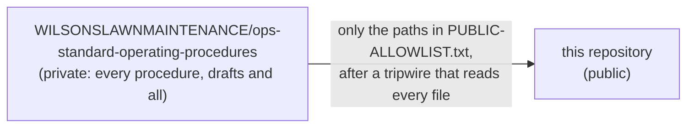

# Wilson's Lawn Maintenance · procedures, the public copy

A **procedure** says how an approved thing is done, step by step, so a person or their helper can do it without the
author in the room. This repository holds only the procedures the business's owner has chosen to show visitors, copied
here by a machine from the business's private procedures. Nobody edits it by hand.

## How the pages get here

- **Allowlist, not exclude list.** A procedure is private until an owner lists it. Forgetting to list one leaves it
  private: the safe failure.
- **Every file is read before it leaves.** Text, the words inside every PDF, the text inside office files; anything a
  machine cannot read waits until a person has opened it and said so. Keys, agent notes and legal folders never leave.
- **Nothing has arrived yet** if this page is the only one here: the copy waits for its key, and for the owner's yes.

| This repository holds | Written by |
| --- | --- |
| this `README.md`, `banner/`, `LICENSE`, `LICENSE-CONTENT` | by hand, by pull request |
| every other file (the procedures, their PDFs, `assets/icons/`) | the automatic copy only; never edited here |

Start with **SOP-COM-001** (*New to GitHub: your first hour*) and **SOP-OPS-001** (*How a change travels*) once they are
here. The business's welcome deck is on its profile: [github.com/WILSONSLAWNMAINTENANCE](https://github.com/WILSONSLAWNMAINTENANCE).

Wilson's Lawn Maintenance on GitHub · code MIT, words CC BY-SA 4.0 (`LICENSE`, `LICENSE-CONTENT`); the business's name and marks belong to the business. Kept by the drasticstatic lab, a brother's gift.
